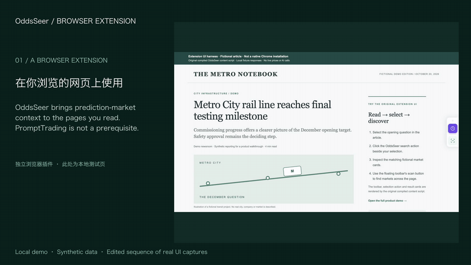
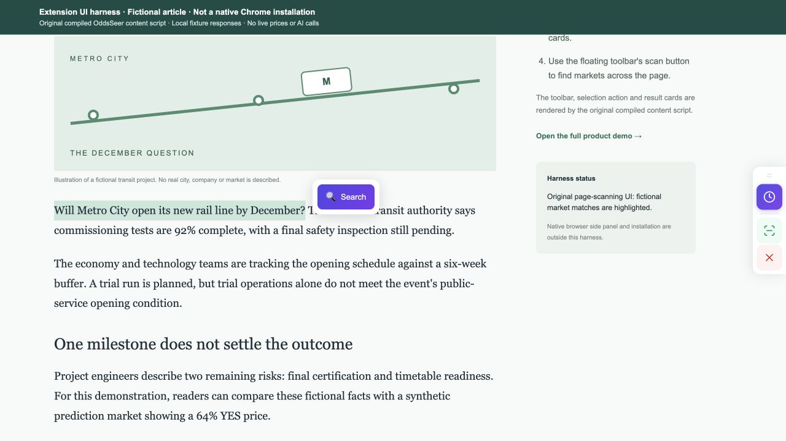
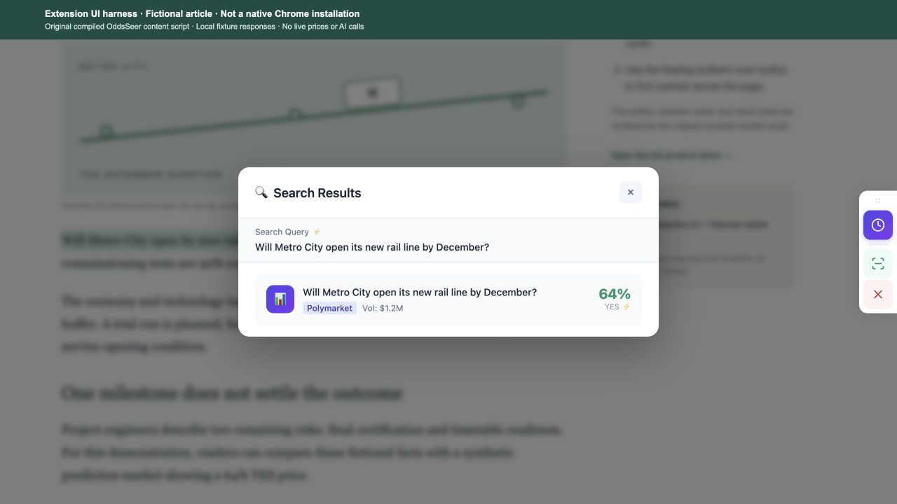

# OddsSeer

A browser extension that brings prediction-market context to ordinary webpages. Select text or scan a page to discover related Polymarket and Kalshi markets, inspect public market data, and keep a local watchlist.

[中文说明](README.zh-CN.md) · [Architecture](docs/ARCHITECTURE.md) · [Security and privacy](SECURITY.md) · [Verification status](docs/VERIFICATION.md)

## See it in action

**Read a webpage → select a question → discover related prediction markets in context.**

[Download the 19-second MP4](docs/media/oddsseer-extension-intro.mp4?raw=true) · [Full screenshot and GIF gallery / 中文图文介绍](docs/DEMO.md)

> This earlier interaction demo runs the original extension content script on a fictional local article with fixture market data. The video is an edited sequence of actual UI captures. It demonstrates the interaction, not native Chrome installation or cross-site acceptance of this release.



| Select a question on a page | Inspect the related market |
| --- | --- |
|  |  |

Find a question while reading, search for related markets, inspect public prices and choose what to follow. There is no requirement to open PromptTrading first.

The full gallery also preserves historical workspace screenshots, including the Chinese UI, sample analysis, paper positions and virtual credits. Those are labeled historical demos; trading, top-ups and subscriptions are not features of this source release.

## Run locally

Requires Node.js 22.18+ and npm. From this repository:

```sh
npm --prefix extension ci
npm --prefix server ci
npm run build
npm start
```

Load `extension/.output/chrome-mv3` with Chrome's **Extensions → Developer mode → Load unpacked**. The backend listens only on `127.0.0.1:8787`. See [server setup](server/README.md) for origin allowlisting and optional enhanced services. Ordinary public market browsing does not require a wallet, account, database or model key.

After loading, refresh an ordinary webpage. Use the floating toolbar or select a sentence and click the search action. Market links open their public websites. The side panel stores followed markets and alert preferences locally.

## Capabilities and boundaries

- Independent WXT/React Manifest V3 extension; no PromptTrading web app is required.
- Public-market keyword search is the default. It is not the original cross-language semantic search.
- Original hybrid retrieval, RRF, embeddings and reranking code is retained. It requires a separately configured PostgreSQL/pgvector database, imported market records and optional provider keys.
- Original news/price timeline and comment-analysis algorithms are retained. External providers can fail; model-based comment analysis requires a server-side key and explicit extension-origin configuration.
- Watchlists, preferences and price alerts live in the browser. Notifications depend on Chrome and its permissions.
- No wallet creation, key import, deposits, custody, trading or paid subscriptions are enabled. Unused legacy account/payment examples are excluded from the public source tree.
- Chrome internal pages, the extension store and other protected browser surfaces cannot run ordinary content scripts.

## Privacy

The content script can read normal HTTP(S) pages to offer contextual actions. Page scans and selection searches start when you click; their text is sent to your backend or public market search endpoints. Opening a supported prediction-market page may fetch public market data, titles and public comments automatically. **If a server model key and an allowed extension origin are configured, page enhancement can automatically send up to 20 public comments (including usernames) to OpenRouter and incur model charges without an analysis click.** Disable page enhancement or leave the server key unset to opt out. Page URL, title and extracted keywords are collected into the extension worker’s memory when a normal page opens. They are not automatically sent to the backend. Toolbar position uses extension storage, not the visited website’s localStorage. No analytics database is included. Do not send confidential selections to third-party market search services.

Never put a provider key or wallet secret in `VITE_*`: build-time values are public in the extension bundle. `extension/.env.example` contains only the backend origin. Server keys stay in ignored local configuration.

## Validate

```sh
npm run typecheck
npm run build
npm run test:extension
npm run test:server
npm run scan:secrets
```

This initial source release is licensed under [MIT](LICENSE). The original plugin README identified MIT; third-party dependencies retain their own licenses, listed in [Third-party notices](THIRD-PARTY-NOTICES.md).

Typecheck, build and offline tests passed. **Native Chrome loading and cross-site interaction have not been verified.** Optional model/database services require separate setup; the backend is for loopback use. Known dependency findings and independent source-review scope are recorded in [Verification](docs/VERIFICATION.md) and [Review](docs/REVIEW.md).
